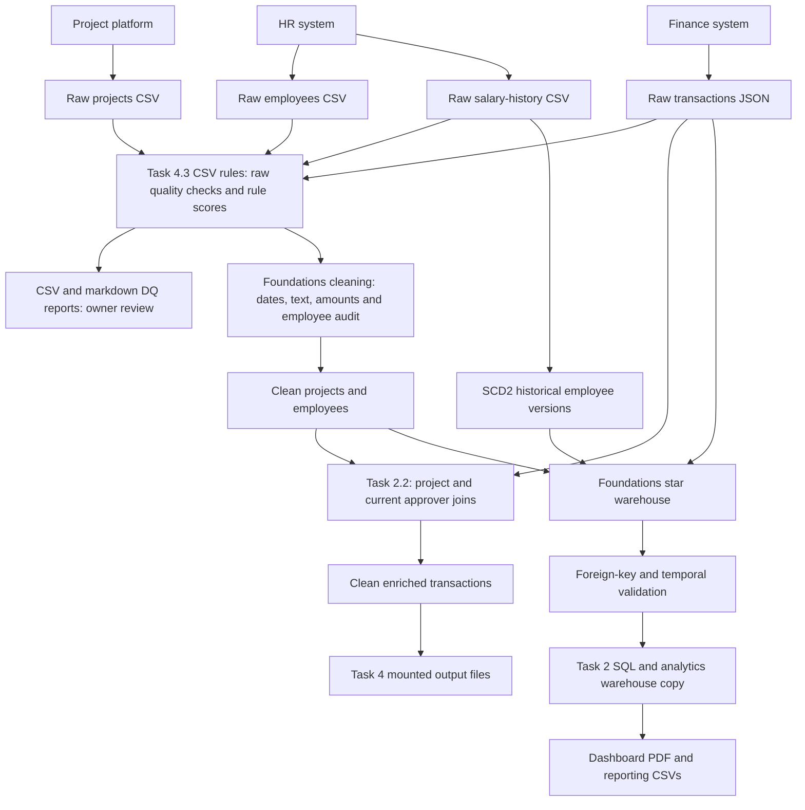

# Task 4.2 — Data Governance Document

Prepared for the assessment on 14 October 2026. Row counts and column names are measured from the supplied files. Source systems, update schedules, growth estimates, owners and business retention periods are proposed assumptions, not confirmed company policy. Access and disposal controls described here must be implemented separately in production.

## 1. Data inventory

| Dataset | Assumed source system | Format | Proposed update frequency | Measured volume | Estimated daily growth |
|---|---|---|---|---|---|
| projects | Project management platform | CSV | Daily snapshot | 500 rows | 1 new project plus updates |
| employees | HR information system | CSV | Daily snapshot | 1,000 rows | 1 new employee plus updates |
| transactions | Finance / accounts payable | JSON array | Daily incremental extract | 50,000 rows | 200 transactions |
| employees_salary_history | HR compensation / payroll | CSV | Daily extract of approved changes | 1,826 rows | 5 change events |

Growth figures are planning estimates; validate them with operational logs. Snapshots replace older snapshots rather than append every row daily. Transactions and salary changes append after duplicate checks.

## 2. Data classification

| Classification | Meaning |
|---|---|
| Public | Approved for sharing outside the organisation |
| Internal | Routine company information |
| Confidential | Restricted business or financial information |
| Personal (PII) | Information identifying a person directly or through linked records |

None of the supplied columns is approved as Public. PII takes precedence in the tables: salary is personal and highly confidential. Employee IDs are linkable identifiers, not anonymous data. Employment attributes are personal when stored against an identifiable employee.

**Regulation label:** “UAE PDPL; GDPR if applicable” means the UAE federal privacy law applies where the processing falls within its scope, and GDPR additionally applies where Article 3 territorial criteria are met. EU nationality alone does not establish GDPR applicability. Confirm the organisation's jurisdiction, exceptions and any applicable DIFC/ADGM rules before deployment. Sources: [UAE government privacy-law overview](https://u.ae/en/about-the-uae/digital-uae/data/data-protection-laws.) and [GDPR Articles 3, 4 and 5](https://eur-lex.europa.eu/eli/reg/2016/679/oj/eng).

### projects.csv

| Column | Classification | Regulation | Reason |
|---|---|---|---|
| project_id | Internal | — | Project identifier |
| project_name | Confidential | — | May disclose a client or initiative |
| department | Internal | — | Project organisational grouping |
| status | Internal | — | Project progress |
| start_date | Internal | — | Project schedule |
| end_date | Internal | — | Project schedule |
| budget | Confidential | — | Planned spending |
| actual_cost | Confidential | — | Actual spending |
| project_manager_id | Personal (PII) | UAE PDPL; GDPR if applicable | Links to an identifiable employee |
| priority | Internal | — | Work prioritisation |
| region | Internal | — | Project operating region |

### employees.csv

| Column | Classification | Regulation | Reason |
|---|---|---|---|
| employee_id | Personal (PII) | UAE PDPL; GDPR if applicable | Linkable employee identifier |
| full_name | Personal (PII) | UAE PDPL; GDPR if applicable | Direct identification |
| email | Personal (PII) | UAE PDPL; GDPR if applicable | Identifying contact address |
| department | Personal (PII) | UAE PDPL; GDPR if applicable | Employee affiliation |
| role | Personal (PII) | UAE PDPL; GDPR if applicable | Job information |
| level | Personal (PII) | UAE PDPL; GDPR if applicable | Employee seniority |
| hire_date | Personal (PII) | UAE PDPL; GDPR if applicable | Employment history |
| salary | Personal (PII) | UAE PDPL; GDPR if applicable | Restricted compensation information |
| manager_id | Personal (PII) | UAE PDPL; GDPR if applicable | Identifies the manager and reporting relationship |
| region | Personal (PII) | UAE PDPL; GDPR if applicable | Employee location |
| status | Personal (PII) | UAE PDPL; GDPR if applicable | Employment status |
| years_experience | Personal (PII) | UAE PDPL; GDPR if applicable | Career information |

### transactions.json

| Column | Classification | Regulation | Reason |
|---|---|---|---|
| transaction_id | Confidential | — | Financial record identifier |
| project_id | Internal | — | Project relationship |
| vendor_id | Personal (PII) | UAE PDPL; GDPR if applicable | May identify an individual supplier |
| vendor_name | Personal (PII) | UAE PDPL; GDPR if applicable | May name an individual or sole trader |
| category | Internal | — | Spending classification |
| amount | Confidential | — | Financial value |
| currency | Internal | — | Currency code |
| transaction_date | Confidential | — | Financial activity date |
| approved_by | Personal (PII) | UAE PDPL; GDPR if applicable | Identifies the approving employee |
| payment_status | Confidential | — | Payment obligations |
| invoice_ref | Confidential | — | Financial document reference |
| notes | Personal (PII) | UAE PDPL; GDPR if applicable | Free text may contain personal information |

### employees_salary_history.csv

| Column | Classification | Regulation | Reason |
|---|---|---|---|
| employee_id | Personal (PII) | UAE PDPL; GDPR if applicable | Identifies the employee |
| previous_salary | Personal (PII) | UAE PDPL; GDPR if applicable | Historical compensation |
| new_salary | Personal (PII) | UAE PDPL; GDPR if applicable | Revised compensation |
| previous_role | Personal (PII) | UAE PDPL; GDPR if applicable | Previous employment role |
| new_role | Personal (PII) | UAE PDPL; GDPR if applicable | Revised employment role |
| previous_level | Personal (PII) | UAE PDPL; GDPR if applicable | Previous seniority |
| new_level | Personal (PII) | UAE PDPL; GDPR if applicable | Revised seniority |
| effective_date | Personal (PII) | UAE PDPL; GDPR if applicable | Date of an individual employment change |
| change_type | Personal (PII) | UAE PDPL; GDPR if applicable | Nature of an employment change |
| change_reason | Personal (PII) | UAE PDPL; GDPR if applicable | May reveal personal performance or circumstances |

Vendor identifiers/names are conservatively treated as PII because suppliers may be individuals. Verified corporate-only vendor records may be classified Confidential instead. Escalate invoice references or project names to PII if they embed personal identifiers. Restrict free-text notes until reviewed.

Cleaned tables, warehouse versions, linked facts, exports and backups inherit source classifications. Removing names while retaining employee IDs is pseudonymisation, not full anonymisation. Wider aggregate reporting needs small-group suppression and checks against re-identification.

## 3. Data ownership

| Dataset | Data Owner | Data Steward | Access approver |
|---|---|---|---|
| projects | Head of PMO | Project operations analyst | PMO owner; Privacy for PII |
| employees | HR Director | HR data specialist | HR Director and Privacy |
| transactions | Finance Director | Accounts payable lead | Finance Director; Privacy for PII |
| employees_salary_history | HR Director | Compensation specialist | HR Director; Finance controller for statutory payroll requests |

The Owner decides the approved uses, access and retention policy and is accountable for those decisions. The Steward maintains definitions, investigates quality issues and coordinates corrections day to day. Engineering implements approved controls rather than deciding new uses of HR data.

## 4. Retention policy

| Dataset | Proposed retention | Justification | Disposal method | Enforcer |
|---|---|---|---|---|
| projects | Active life plus 3 years after closure; retain necessary tax evidence for its applicable 7-year window | Project evaluation and audit; financial evidence can support tax filings | Delete expired detail or irreversibly anonymise approved aggregates; restrict archived evidence | PMO steward, Finance and retention service |
| employees | During employment and at least 2 years after service ends; segregate necessary payroll/tax records for longer applicable periods | Personnel administration and labour record obligations | Delete ordinary profile fields at expiry; retain only required evidence in a restricted archive | HR steward, Privacy and retention service |
| transactions | At least 7 years after the relevant corporate tax period ends, where applicable | Reconciliation, audit and tax evidence | Restricted archive, then secure deletion after holds expire | Finance controller and retention service |
| employees_salary_history | During employment, then until the later applicable deadline: 2 years after service ends or 7 years after the tax period for tax-supporting records | Payroll accuracy, end-of-service calculations, disputes and tax evidence | Segregated encrypted archive of necessary fields, followed by secure deletion | HR compensation steward, Finance and Legal |

**Salary history needs separate treatment:** its purpose includes proving past payroll changes and supporting end-of-service calculations. Those records may remain necessary after ordinary employee contact/profile information expires. A payroll evidence requirement does not justify retaining every HR attribute indefinitely.

The labour baseline is at least two years after end of service for worker files under Article 13(1) of Federal Decree-Law No. 33 of 2021: [official labour law](https://uaelegislation.gov.ae/en/legislations/1541/download). Relevant corporate-tax records have a seven-year retention period measured after the end of the relevant tax period: [Federal Tax Authority FAQ](https://tax.gov.ae/en/faq.aspx?keyword=How+long+must+I+keep+my+records+for+UAE+CT+purposes%3F). Legal/Finance must confirm entity-specific requirements, other taxes and longer periods. This does not imply employee salary is subject to personal income tax.

GDPR Article 5 requires keeping identifiable data only as long as needed for its purpose; it does not set one general employee retention period. See [GDPR](https://eur-lex.europa.eu/eli/reg/2016/679/oj/eng). Document the purpose and expiry of each retained field. Legal holds suspend deletion for relevant evidence and are reviewed quarterly.

Proposed staging retention is 30 days after a validated load; routine backup generations expire after 90 days. Delete expired copies and use deletion records during restores so removed data is not permanently reintroduced. Archiving is not a substitute for eventual disposal.

## 5. Access control

The following levels apply to approved views of data, not unrestricted raw-file access.

| Persona | Projects | Employees | Transactions | Salary History |
|---|---|---|---|---|
| Data Engineer | Read + Write | Read + Write | Read + Write | None |
| BI Analyst | Read | Read | Read | None |
| Finance Team | Read | Read | Read + Write | None |
| HR Team | Read | Read + Write | None | Read + Write |
| Executive | Read | Read | Read | None |

- Engineers use scoped service identities and masked employee views. Production salary-history loading uses a separate HR-approved service account, without granting routine human browsing access.
- BI analysts see reporting views and employee headcount aggregates, without individual salary, names, email, approver identities or transaction notes.
- Finance sees current payroll/identity information only where required for reconciliation. Historical salary access is exceptional, approved and time-limited.
- Salary-history access within HR is limited to compensation staff. Ordinary HR users do not automatically receive it.
- Executives receive aggregate views with small-group suppression, rather than individual compensation rows.
- No listed persona receives routine Full (including delete). A separate audited retention service performs approved deletion.

Use SSO/MFA, group-based permissions, encryption in transit/at rest, audited access and quarterly access reviews. Revoke permissions after role changes. DQ score reports contain counts, not employee values; correction audits with employee IDs remain PII. The local CSV/SQLite demonstration does not enforce this access matrix—production storage and database permissions must do so.

## 6. Data lineage

The Task 4 entry point runs quality checks on raw data before cleaning, then reuses the existing cleaners/enrichment and saves reports and CSVs. The warehouse build and SQL/dashboard steps are separate earlier pipelines. Rules cover the six required dimensions plus freshness and distribution. Quality warnings remain visible for owner review; they do not mean every issue was fixed. Source files are preserved, and lineage includes the correction audit and retained employee versions.
